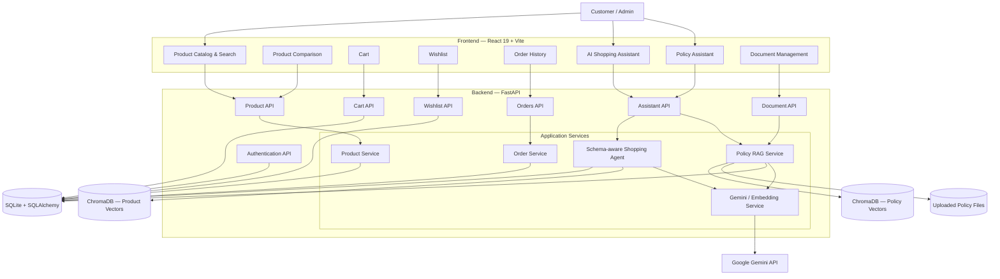
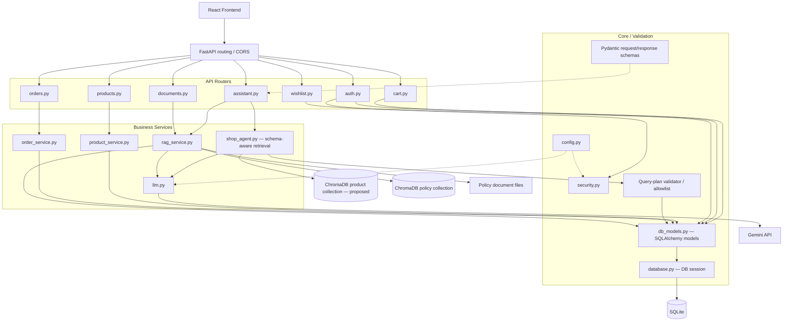
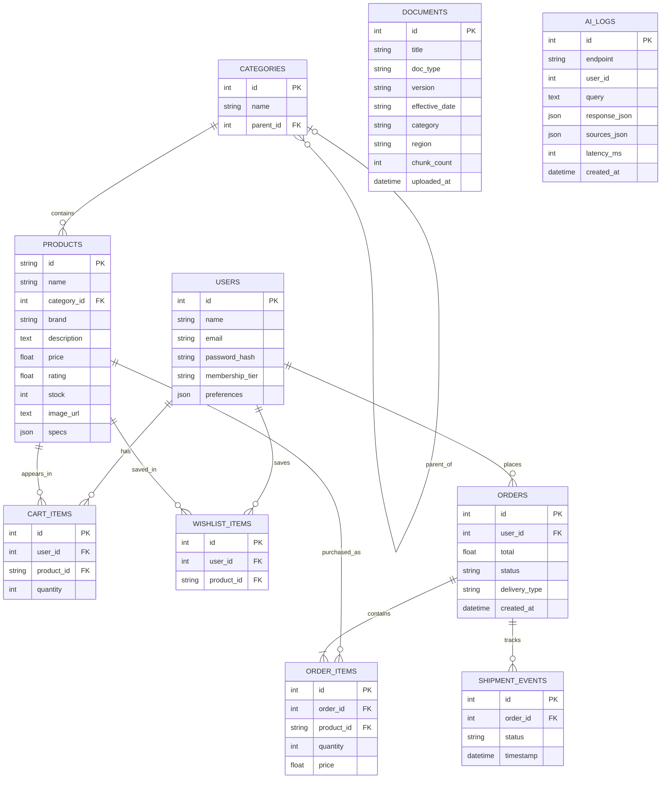
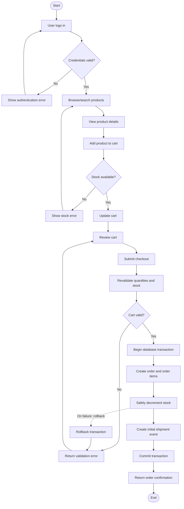
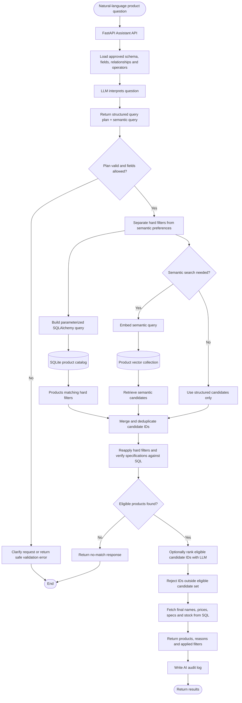
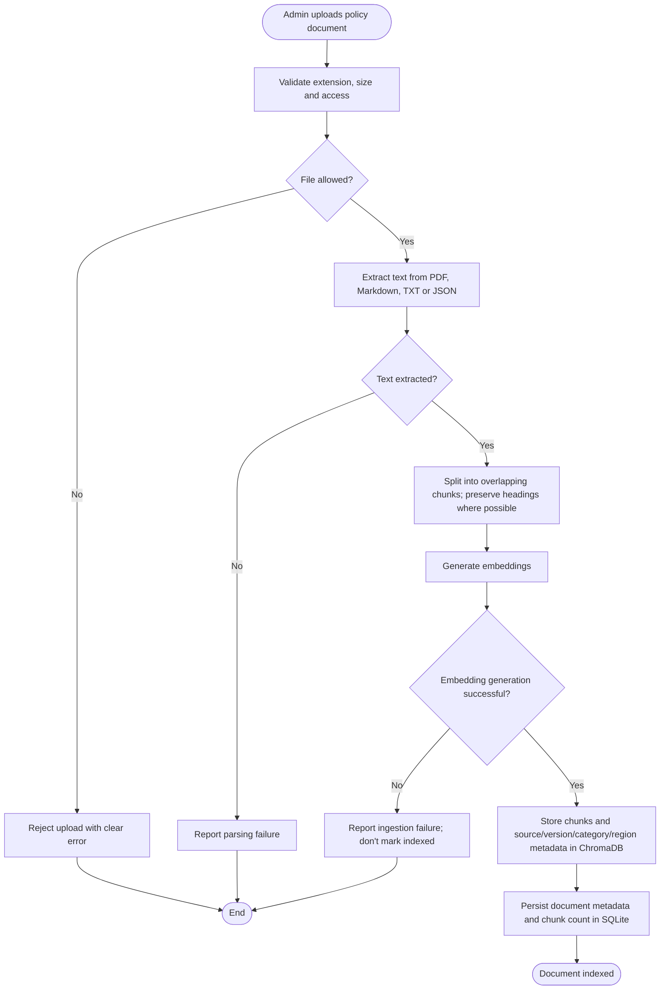
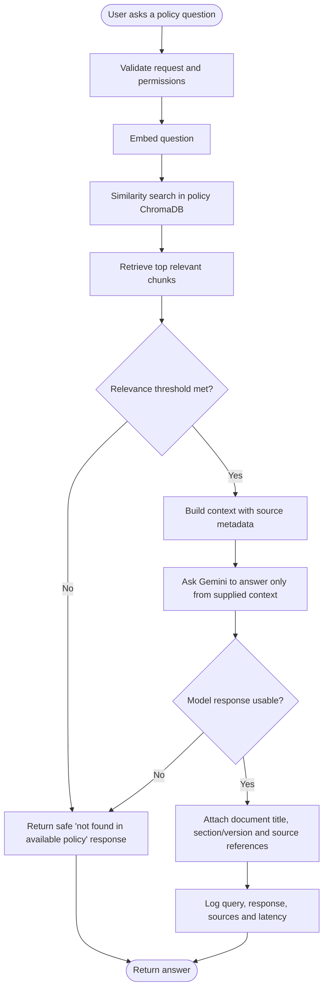

# ShopSmart AI — System Design

ShopSmart AI is an AI-assisted shopping application with a React/Vite frontend, FastAPI backend, SQLAlchemy/SQLite relational storage, Gemini-powered language-model operations, and ChromaDB retrieval for policy documents. This document captures the system architecture and four core workflows in GitHub-renderable Mermaid.

> **Implementation status:** The diagrams combine the project structure discussed so far with proposed enhancements. In particular, a dedicated product-vector collection and schema-aware hybrid product retrieval are proposed additions, not assumed to exist in the current code. Confirm names, routes, and behavior against the repository before treating this document as a source-of-truth implementation specification.

## Contents

- [High-Level Design](#1-high-level-design-hld)
- [Low-Level Design](#2-low-level-design-lld)
- [Entity Relationship Diagram](#3-entity-relationship-diagram-erd)
- [Workflow 1: Shopping and Checkout](#4-workflow-1-shopping-and-checkout)
- [Workflow 2: LLM-Driven Hybrid Product Search](#5-workflow-2-llm-driven-hybrid-product-search)
- [Workflow 3: Policy Document Ingestion](#6-workflow-3-policy-document-ingestion)
- [Workflow 4: Policy RAG Question Answering](#7-workflow-4-policy-rag-question-answering)
- [Design and Security Notes](#8-design-and-security-notes)
- [Repository Layout](#9-repository-layout)

## 1. High-Level Design (HLD)

The HLD shows the user-facing application, API layer, business services, AI provider, and persistence systems.



## 2. Low-Level Design (LLD)

This view separates API routers, application services, core infrastructure, models/schemas, and external stores.



## 3. Entity Relationship Diagram (ERD)

The ERD reflects the discussed SQLAlchemy entities. `AI_LOGS.user_id` is intentionally not connected to `USERS` because the current model was described as not declaring it as a foreign key. The cart and wishlist models have unique `(user_id, product_id)` constraints.



## 4. Workflow 1: Shopping and Checkout

The workflow validates the cart again at checkout. In production, order creation, order-item insertion, and stock deduction should run in a transaction with safe concurrency controls.



## 5. Workflow 2: LLM-Driven Hybrid Product Search

Example question: **“Find all laptops under ₹70,000 with an OLED screen that are good for programming.”**

1. Provide Gemini with the user question, approved schema metadata, allowed fields/operators, and the expected structured output.
2. Gemini returns a **query plan**, not unrestricted database permissions. The plan separates exact filters from semantic preferences.
3. Validate every field, operator, value type, limit, and sort option.
4. Use parameterized SQLAlchemy expressions for exact conditions such as price, category, stock, and structured screen type.
5. If semantic matching is needed, query a **separate product-vector collection**. This collection must be created and populated; the existing policy-vector collection is not a product index.
6. Merge candidates and reapply hard constraints using authoritative database values.
7. Optionally use Gemini to rank only eligible candidate IDs. Validate IDs and fetch final product details from SQL.



### Example query-plan contract

This is an illustrative JSON contract; adapt field names to the actual schema and categories.

```json
{
  "intent": "product_search",
  "filters": [
    {"field": "category_id", "operator": "category_equals", "value": "laptop"},
    {"field": "price", "operator": "lte", "value": 70000},
    {"field": "specs.screen_type", "operator": "equals", "value": "OLED"},
    {"field": "stock", "operator": "gt", "value": 0}
  ],
  "semantic_query": "Laptop suitable for programming",
  "semantic_search_enabled": true,
  "top_k": 10,
  "sort": "relevance"
}
```

**Security rules:** never execute arbitrary LLM text as SQL; use an allowlist and typed query plan, parameterized SQLAlchemy filters, read-only access for search, query timeouts/limits, and authoritative post-filtering. The LLM should not receive database credentials or unrestricted tool access.

## 6. Workflow 3: Policy Document Ingestion

This workflow indexes policy files for later RAG retrieval. The discussed splitter uses approximately 700-character chunks with 100-character overlap; metadata includes document identity and relevant source attributes.



## 7. Workflow 4: Policy RAG Question Answering

This workflow is separate from product semantic search. It retrieves policy passages, uses them as grounded context, and returns source metadata.



## 8. Design and Security Notes

- **Two vector-search domains:** keep product embeddings and policy-document embeddings logically separate, even if both use ChromaDB.
- **Hard filters are authoritative:** price ceilings, stock availability, brand constraints, and structured attributes must be verified against SQL before results are returned.
- **Schema exposure:** give the LLM only the schema metadata needed for query planning. Do not send credentials or the entire database.
- **Structured output:** prefer a typed JSON query plan over raw SQL. Validate table/column allowlists, operators, types, limits, and sorting.
- **Semantic retrieval is optional:** queries consisting entirely of exact filters may not need vector search.
- **Fallbacks:** handle unavailable LLM/embeddings, invalid plans, no results, vector-store failures, and insufficient RAG context.
- **Checkout consistency:** use transactions and concurrency-safe stock updates.
- **Auditability:** record the query, selected filters, retrieval sources, latency, and response metadata while avoiding unnecessary sensitive data.
- **Demo boundaries:** payment processing and carrier integrations are not represented as live integrations.

## 9. Repository Layout

```text
ShopSmartAI/
├── README.md
└── docs/
    └── diagrams/
        ├── hld.mmd
        ├── lld.mmd
        ├── erd.mmd
        ├── workflow-1-checkout.mmd
        ├── workflow-2-ai-hybrid-search.mmd
        ├── workflow-3-policy-ingestion.mmd
        └── workflow-4-policy-rag-query.mmd
```

GitHub renders Mermaid diagrams embedded in Markdown fences. The `.mmd` files keep the source diagrams separate and reusable; copy a diagram into a ` ```mermaid ` block in the README when you want it rendered inline.
